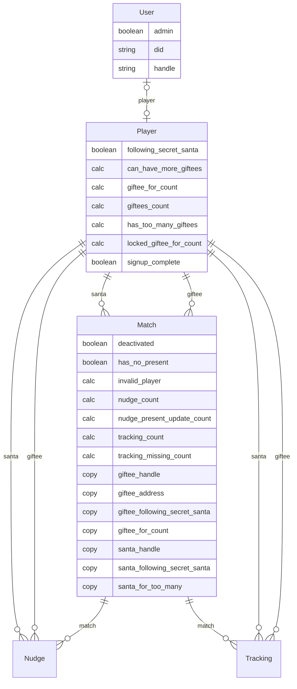
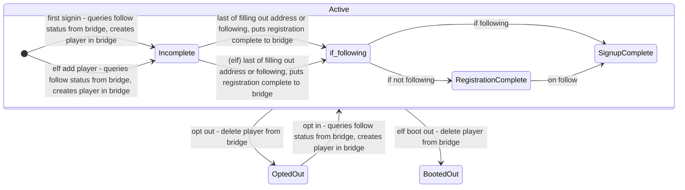

## Entities



## Backend Workflow
### Update Player Counts

```
Player.giftee_for_count = count matches where giftee = player
Player.giftees_count = count matches where santa = player
Player.locked_giftee_for_count = count matches where santa = player AND status locked

Player.can_have_more_giftees = player.giftees_count < player.max_giftees
Player.has_too_many_giftees = player.giftees_count > player.max_giftees

For each match where giftee = player:
  match.giftee_for_count = player.giftee_for_count

For each match where santa = player:
  match.santa_for_too_many = player.has_too_many_giftees
```

### Player Changed

```
Player.signup_complete = !deactivated & address & game_mode & following

For each match where giftee = player:
  match.giftee_handle = player.bluesky_handle
  match.invalid_player = match.santa.deactivated || match.giftee.deactivated
  match.giftee_address = player.address
  match.giftee_following_secret_santa = player.following_secret_santa

For each match where santa = player:
  match.santa_handle = player.bluesky_handle
  match.invalid_player = match.santa.deactivated || match.giftee.deactivated
  match.santa_following_secret_santa = player.following_secret_santa

Trigger => Update Player Counts
```

### Tracking Changed

```
tracking.match.tracking_count = count tracking where tracking.match = match
tracking.match.tracking_missing_count = count tracking where tracking.match = match and missing
tracking.match.has_no_present = tracking.match.tracking_count = 0 || tracking.match.tracking_missing_count = 1
```

## Logged In Header Workflow

### When Logged Out
```
go to login page
```

### When Logged In

```
if player is deactivated:
  go to opt out or deactivated page
```

## Login Page Workflow

### When Logged in

```
if user.player is null:
  user.player = player where player.bluseky_did = user.bluesky_did
if player is deactivated:
  go to opt out or deactivated page
else if user.player is null && signups closed
  go to signups closed
else
  sync player to bluesky bridge
  if user.player is null:
    create player
      bluesky_handle = bridge.handle
      bluesky_did = bridge.did
      following_secret_santa = bridge.following_secret_santa
    set user.player = created player
  go back to page
```

## User Page Workflow

### When Logged In

```
if player.address is empty => show fill in address
if player.game_mode is empty => show fill in game_mode
```

## Player Lifecycle



# External interfaces & Roles

## Web application

The web application is the main public interface of the application and provides three levels of access:

* Public - accessible without login
* Player - accessible to all logged in users
* Elf - accessible to users who are identified as "admin" for running the game.

There are two special cases:
* "Booted out Player" which is a player logging in who has been booted from the game by the elves. These should
  have their session immediately terminated and see a booted out message while being able to take no actions.
  Note that an Elf who is booted out should still see the booted out message but their session should not be
  terminated and should be able to continue to elf functionality.
* "Opted out Player" which is a player logging in who has opted out. These users are still only shown a "opted out"
  screen but unlike booted out their session is not terminated. While signups are open they can opt back in but
  that should be the only action taken

### Public access

Unauthenticated users (i.e. Public access) should be able to see:
* Login / Signup screen
* FAQ page
* Rules page

The only action they should be able to take is Login / Signup and the only data they should be able to access is:
* Game dates from settings
* Game hashtag from settings
* Elf list from settings

# Player access

Players should be able to see  their own profile and:
* Edit address up until they are the locked giftee of someone
* Edit their game mode until signups close.

Players with a game mode of Santa Only should never be prompted for an address

Players should be able to take the following actions:
* Enter nudges for giftees assigned to them via a match
* Enter tracking for giftees assigned to them via a match
* Mark a tracking for a match where they are the giftee as missing or arrived
* Opt out

Players should only be able to see:
* Their own address / game mode
* Address, delivery instructions, and handle for the giftee player of matches where they are santa
* Nudges and tracking for matches where they are the santa
* Tracking for matches where they are the santa
* Badges assigned to that player

Specifically players must not be able to access:
* Address or any information about any player other than themselves and their giftee
* Any details of matches where they are not the santa
* Any information about their giftee other than listed above
* Any information about their santa other than the tracking listed above

# Elf access

Elves can:
* see and edit details of all players and their game modes
* enter nudges and tracking on behalf of players
* opt out or boot out players as well as reactivating oped out or booted out players
* change settings, assign badges etc


## Bluesky Feeds

In addition to the web application there are three bluesky feeds provided under the `/xrpc/` path:
* gifteeFeed - should only return posts to players with an associated giftee and only the posts of their giftee
* hashtagFeed and hashtagWithRepliesFeed - should be visible to any bluesky user, should include posts using various hashtags but exclude posts by booted out players